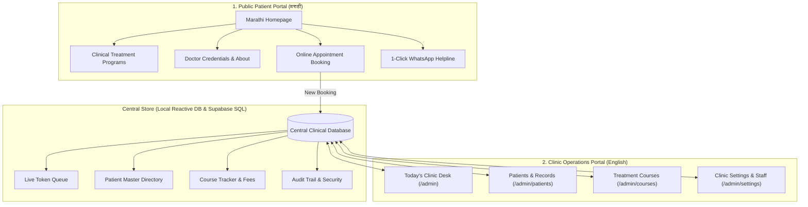
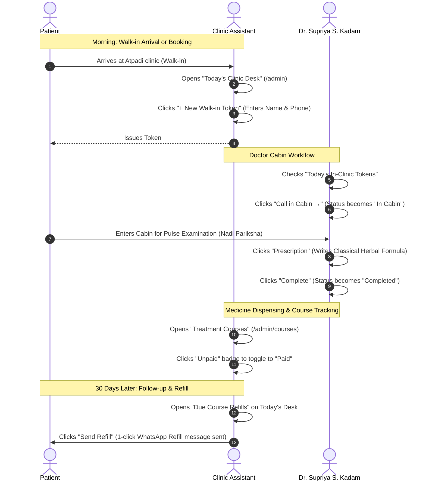

# Vijaymangal Ayurved — Complete Project Walkthrough & System Architecture

> [!NOTE]
> **Practice Identity**: Vijaymangal Ayurved (विजयमंगल आयुर्वेद)  
> **Practitioner**: Dr. Supriya Shreeprasad Kadam, M.D. (Ayurveda)  
> **Location**: Atpadi, Sangli District, Maharashtra  
> **Contact / Helpline**: `+91 8263902142`  
> **System Purpose**: Dual-sided digital healthcare platform combining an authentic **Marathi public patient portal** with an intuitive, streamlined **English clinic automation system**.

---

## 1. Project Vision & Core Direction

### Why This Project Exists
Small-scale Ayurvedic practices in semi-urban and rural Maharashtra (like Atpadi) face two distinct challenges:
1. **Patient Communication Gap**: Local patients seeking Ayurvedic solutions for chronic conditions (Sandhivata/Joint pain, Infertility, PCOD, chronic skin allergies, digestive disorders) need clear, dignified explanations in their native language (**Marathi**), without confusing medical jargon or commercial marketing gimmicks.
2. **Administrative Chaos**: Most clinics manage patient records on paper slips or over-complicated hospital ERPs built for 500-bed multi-specialty hospitals. What a single practitioner clinic actually needs is **small-scale, practical clinic automation** that runs smoothly on desktop or mobile with zero friction.

### The Architectural Solution: Two Synchronized Portals



---

## 2. Public Patient Portal (मराठी)

The public-facing website is purposefully built in **clean, classical, accessible Marathi** to instill trust, explain root causes (*Nidan*), and outline treatment plans.

### Key Public Sections

| Section / Route | Purpose & Clinical Philosophy | Key Features |
| :--- | :--- | :--- |
| **[Homepage](file:///d:/websites/vijaymangal/src/app/page.tsx)** (`/`) | Introduction to Dr. Supriya S. Kadam, classical Ayurvedic principles, and core specializations. | Dynamic hero banner, authentic treatment highlights, 6-pillar benefit strip with gradient backdrop, video testimonials, verified clinic timing badge. |
| **[About Dr. Supriya](file:///d:/websites/vijaymangal/src/app/about/page.tsx)** (`/about`) | Academic credentials and 10+ years clinical heritage in classical Ayurveda. | M.D. (Ayurveda) degree verification, Nadi Pariksha expertise, holistic healing methodology, Atpadi clinic heritage. |
| **[Treatments & Courses](file:///d:/websites/vijaymangal/src/app/treatments/page.tsx)** (`/treatments`) | In-depth breakdown of condition-specific programs. | Dedicated guides for Sandhivata, Infertility (वंध्यत्व), PCOD/Hormonal care, Chronic Skin diseases, and Amlapitta (Hyperacidity). |
| **[Consultation Booking](file:///d:/websites/vijaymangal/src/app/contact/page.tsx)** (`/contact`) | Friction-free appointment booking form. | Patient selects preferred date, time slot, and health category. Instantly syncs into the admin dashboard for clinic verification. |

> [!TIP]
> **Contextual Marathi WhatsApp**: Instead of an isolated chat widget, the public site uses context-aware WhatsApp triggers that pre-fill relevant Marathi messages based on the page the patient is browsing (e.g. asking specifically about Sandhivata treatment or confirming an appointment).

---

## 3. Clinic Operations Admin Portal (English)

The admin portal is strictly designed in **English** for efficiency, fast typing, keyboard navigation, and clinical clarity. It is organized into **4 Primary Daily Pillars**:

```
┌────────────────────────────────────────────────────────────────────────┐
│                        VIJAYMANGAL AYURVED ADMIN                       │
└────────────────────────────────────────────────────────────────────────┘
  │
  ├─ 1. Today's Clinic Desk (/admin)
  │     └─ All daily operations: Live OPD Queue, Booking Requests, Refills
  │
  ├─ 2. Patients & Records (/admin/patients)
  │     └─ Patient Master Directory, Clinical Visits, Rx Composer & Printing
  │
  ├─ 3. Treatment Courses (/admin/courses)
  │     └─ 1-Mo & 4-Mo Programs, Days Left, 1-Click Fee Toggle, Renewal
  │
  └─ 4. Clinic Settings & Team (/admin/settings)
        └─ Practice Timings, Staff Accounts, Revenue Reports, Audit Trail
```

---

### Pillar 1: [Today's Clinic Desk](file:///d:/websites/vijaymangal/src/app/admin/page.tsx) (`/admin`)

#### Why this section exists:
In a daily clinic routine, the doctor or receptionist should not have to navigate 5 different pages just to find out who is waiting outside, who booked online today, and who needs a medicine refill. **Everything happening today is consolidated onto this single screen.**

#### How to use it:

1. **Viewing Waiting Patients (Live OPD Queue)**:
   * View live tokens in sequence: `Token #1`, `Token #2`, `Token #3`...
   * Status tags clearly indicate whether the patient is `Waiting`, `In Cabin` (with the doctor), or `Completed`.
   * **1-Click Call into Cabin**: Click `Call in Cabin →` when Dr. Supriya is ready. This automatically updates the status and records the consult timestamp.
   * **1-Click Write Rx**: Click `Prescription` to immediately open the prescription writer for this patient.
   * **1-Click Mark Done**: Click `Done` once consultation and dispensing are complete.

2. **Registering Walk-In Patients**:
   * Click the prominent gold button `+ New Walk-in Token`.
   * Fill in **Patient Name**, **Mobile Number**, and **Complaint/Reason**.
   * Click `Issue OPD Token`. The system generates the next token number instantly and places the patient in the live queue.

3. **Handling Website Bookings (Tab 2: Today's Bookings)**:
   * Shows online consultation requests received from the public website.
   * Click `Reminder` to send an instant pre-formatted WhatsApp message confirming their time slot.
   * When the patient arrives at the clinic, click `Admit to OPD →`. The system automatically issues an OPD token without having to re-enter their details.

4. **Handling Due Medicine Refills (Tab 3: Course Refill Reminders)**:
   * Displays patients on ongoing 1-Month or 4-Month packages whose medicine supply finishes today.
   * Click `Send Refill` to trigger a 1-click WhatsApp reminder notifying the patient that their next medicine dose is ready for pickup or follow-up checkup.
   * Click `Mark Done` once the communication or refill has been handled.

---

### Pillar 2: [Patients & Records](file:///d:/websites/vijaymangal/src/app/admin/patients/page.tsx) (`/admin/patients`)

#### Why this section exists:
Acts as the central electronic health records (EHR) database for all registered patients. It allows instant lookup of any patient's entire clinical history across past visits, courses, and prescriptions.

#### How to use it:

1. **Searching Patients**:
   * Use the search bar to find patients instantly by **Name**, **Mobile Number**, or **Patient ID** (e.g. `VMA-2026-0001`).
   * Filter by status (`Active`, `Completed`, `Paused`).
   * The system automatically detects potential duplicate phone numbers and displays an alert banner if shared family contact numbers exist.

2. **Sub-Navigation Tabs**:
   * **`1. All Patients`**: Master patient table.
   * **`2. Prescriptions (Rx)`**: Opens [`/admin/prescriptions`](file:///d:/websites/vijaymangal/src/app/admin/prescriptions/page.tsx) to compose, view, or print clinical prescriptions.
   * **`3. Clinical Visits`**: Opens [`/admin/visits`](file:///d:/websites/vijaymangal/src/app/admin/visits/page.tsx) to record consultation notes, symptoms, pulse (*Nadi*) diagnosis, and therapeutic response.

3. **Patient 360° Profile ([`/admin/patients/[id]`](file:///d:/websites/vijaymangal/src/app/admin/patients/%5Bid%5D/page.tsx))**:
   * Click on any patient's name to view their complete dossier.
   * Displays medical background, active treatment courses, past prescription slips, historical visit progress, and direct 1-click WhatsApp buttons.

---

### Pillar 3: [Treatment Courses & Fees](file:///d:/websites/vijaymangal/src/app/admin/courses/page.tsx) (`/admin/courses`)

#### Why this section exists:
Classical Ayurvedic healing for chronic conditions works in structured cycles (typically **1-Month** or **4-Month** programs). This section tracks ongoing packages, timeline adherence, payment status, and renewals.

#### How to use it:

1. **Assigning a Treatment Course**:
   * Click `+ New Treatment Course`.
   * Select patient, program type (e.g. *Sandhivata & Joint Care Program*, *Amlapitta & Digestive Restoration*), duration (1 Month or 4 Months), and agreed fee.
   * The system automatically sets the start date, planned end date, and scheduled monthly follow-up tasks.

2. **1-Click Fee Toggle (`Paid` ⇄ `Unpaid`)**:
   * Small clinics do not need heavy multi-step invoicing.
   * Simply click the `PAID` or `UNPAID` badge in the table to toggle payment status instantly.

3. **1-Click Refill Reminder**:
   * In the actions column, click `Send Refill` to send a pre-filled WhatsApp alert notifying the patient to collect their next monthly batch.

4. **1-Click Course Renewal**:
   * When a patient completes their 4-month cycle and requires maintenance or a subsequent cycle, click `Renew`. The system completes the old course and initializes the new cycle with pre-set dates.

---

### Pillar 4: [Clinic Settings & Team](file:///d:/websites/vijaymangal/src/app/admin/settings/page.tsx) (`/admin/settings`)

#### Why this section exists:
Consolidates all administrative configuration, team accounts, performance analytics, and security audit logs in one central hub with shared top tabs.

```
[1. Practice Info & Timings]   [2. Staff Accounts]   [3. Practice Reports]   [4. Audit Trail]
```

#### The 4 Integrated Subsections:

| Sub-Tab / Route | Clinical & Administrative Purpose |
| :--- | :--- |
| **`1. Practice Info`** ([`/admin/settings`](file:///d:/websites/vijaymangal/src/app/admin/settings/page.tsx)) | Configure Marathi and English clinic names, Dr. Supriya's qualifications, official mobile helpline, address in Atpadi, and consultation hours. Updates public pages automatically. |
| **`2. Staff Accounts`** ([`/admin/staff`](file:///d:/websites/vijaymangal/src/app/admin/staff/page.tsx)) | Manage authenticated user accounts and roles (`owner`, `practitioner`, `staff`). Toggle active/disabled status with 1 click to control access. |
| **`3. Practice Reports`** ([`/admin/reports`](file:///d:/websites/vijaymangal/src/app/admin/reports/page.tsx)) | Visual practice analytics: monthly patient intake, active treatment course revenue breakdown, retention percentage, and health category demand. |
| **`4. Audit Trail`** ([`/admin/audit-log`](file:///d:/websites/vijaymangal/src/app/admin/audit-log/page.tsx)) | Immutable security log. Automatically tracks who registered a patient, who issued an OPD token, who changed payment status, and who wrote a prescription with timestamp and actor details. |

---

## 4. End-to-End Clinic Daily Workflow

Here is how a typical day runs at Vijaymangal Ayurved using this system:



---

## 5. Technical Highlights & Code Organization

### File Structure Map

```
d:\websites\vijaymangal\
├── src/
│   ├── app/
│   │   ├── page.tsx                     # Marathi Homepage
│   │   ├── about/page.tsx               # Doctor heritage & credentials
│   │   ├── treatments/page.tsx          # Classical condition guides
│   │   ├── contact/page.tsx             # Booking & location
│   │   └── admin/                       # Clinic Operations Hub (English)
│   │       ├── layout.tsx               # 4-Pillar consolidated sidebar
│   │       ├── page.tsx                 # Pillar 1: Today's Clinic Desk
│   │       ├── patients/                # Pillar 2: Patients & Records
│   │       │   ├── page.tsx             # Patient directory
│   │       │   └── [id]/page.tsx        # 360° clinical profile
│   │       ├── courses/page.tsx         # Pillar 3: Treatment Courses & Fees
│   │       ├── settings/page.tsx        # Pillar 4: Clinic Info & Timings
│   │       ├── staff/page.tsx           # Pillar 4: Staff accounts
│   │       ├── reports/page.tsx         # Pillar 4: Practice analytics
│   │       ├── audit-log/page.tsx       # Pillar 4: Security audit trail
│   │       ├── prescriptions/page.tsx   # Prescription writer & print
│   │       ├── visits/page.tsx          # Clinical visit records
│   │       ├── appointments/page.tsx    # Online booking schedule
│   │       └── follow-ups/page.tsx      # Follow-up calendar
│   ├── lib/
│   │   ├── db/
│   │   │   ├── index.ts                 # Reactive store with localStorage sync
│   │   │   └── initial-data.ts          # Seed patient, OPD & course data
│   │   └── whatsapp.ts                  # Contextual 1-click WhatsApp engine
│   └── types/
│       └── database.ts                  # TypeScript clinical schemas
└── supabase/
    └── migrations/20261023_init_schema.sql  # Production Postgres schema
```

### Key Technical Patterns
1. **Persistent Local DB + Supabase SQL Ready**: The application features a reactive client-side store (`src/lib/db/index.ts`) that persists all changes to browser `localStorage` across page reloads. Simultaneously, a complete PostgreSQL schema in `supabase/migrations/20261023_init_schema.sql` matches these exact types for seamless cloud database deployment.
2. **Contextual Action Pattern**: Rather than an isolated "WhatsApp Center", WhatsApp functionality is executed contextually wherever needed with pre-formatted clinical Marathi text.
3. **Graceful Routing**: Consolidating the navigation to 4 pillars preserves all dedicated tools (`/admin/prescriptions`, `/admin/visits`, `/admin/appointments`, etc.) as direct sub-navigation pills, ensuring zero broken links or lost functionality.
